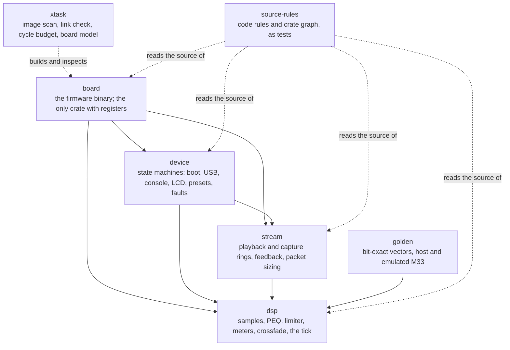

# Architecture

The design has one rule that everything else follows: **only one crate touches hardware.** Every decision the
firmware makes (what a USB request means, when the rate may change, what a console line asks for, what the EQ
does to a sample) lives in a plain Rust crate that builds and tests on the host. The `board` crate turns those
decisions into register writes and owns nothing else.

## Crates

| Crate | Owns | Read first |
|---|---|---|
| `dsp` | Fixed-point samples, gain ramps, RBJ cookbook PEQ design and kernels, the look-ahead limiter, meters, crossfade, and `Pipeline`, the per-tick chain | `src/pipeline.rs`, `src/tick.rs`, `src/peq/` |
| `stream` | Playback and capture rings, the asynchronous feedback controller and the capture packet sizer | `src/machine.rs`, `src/feedback.rs` |
| `device` | Boot sequence, rate change, phantom power, console protocol, LCD screens, USB descriptors and requests, presets, faults | `src/boot.rs`, `src/usb/`, `src/console/`, `src/preset.rs` |
| `golden` | Golden vectors that pin the pipeline's output across profiles, also run on an emulated Cortex-M33 | `vectors/golden.txt` |
| `source-rules` | The code rules as tests: no comments but `// WHY:`, the logic crate graph, register map and table checks | `tests/` |
| `board` | The `no_std` binary: clocks, pins, I2S, USB controller, I2C, LCD bus, the executor | `src/firmware.rs` |
| `xtask` | Host tools: `scan-image`, `link-check`, `budget`, `board-run`, `hand-over` | `src/main.rs` |

`source-rules/tests/logic_crate_graph.rs` enforces the arrows above, so a logic crate that reaches for a register
crate fails `cargo test`.

## The audio tick

USB delivers samples in packets. I2S consumes them a frame at a time. The tick sits between them and runs a fixed
number of frames per call: 6 at 44.1 and 48 kHz, 12 at 88.2 and 96 kHz, and 24 at 176.4 and 192 kHz.

1. Pull one block from the playback ring (`stream`).
2. Mix in the input monitor, apply the trim, then run the 14 biquads of the active coefficient set (`dsp::monitor`,
   `dsp::peq`).
3. Run the limiter and update the meters (`dsp::limiter`, `dsp::meter`).
4. Write the block to the DAC side and read the matching capture block from the ADC side into the capture ring.

The tick is the hot path and has hard rules, enforced on the linked image by `cargo xtask scan-image`: no division,
no FPU instruction (the core runs Non-secure, where VFP faults), no interrupt masking, no indirect call, no panic,
no formatting, no allocation and no libm. `cargo xtask budget` runs the real machine code on a Unicorn-emulated
M33 and prices the worst tick and USB interrupt in instructions against the cycle budget at each clock.

### Changing the EQ without a click

The console never edits live coefficients. `peq begin` opens a staging set, `peq N …` lines fill it, and
`peq commit` designs all 14 biquads off the hot path. The tick then swaps to the new set at a block boundary,
crossfading old into new, so the output stays continuous. A refused line anywhere before `commit` leaves the
playing set untouched.

### Presets and the zero-clip trim

`device::preset` holds three presets: `flat` (bit-perfect, the boot default), `clarity` and `warm`. Each EQ preset
carries a trim chosen so that no steady tone at 0 dBFS can clip. The trim is −⌈peak × 10⌉ / 10 dB, where the peak is
the largest boost from 20 Hz to 20 kHz over every rate and band set the preset can play. `crates/device/tests/preset_sound3.rs`
recomputes the peak from the designed coefficients at every rate and fails if a trimmed preset gains above full
scale, or is trimmed more than 0.5 dB below it. M2X Studio applies the
same rule to user curves, and its `test.mjs` re-derives the built-in trims independently in JavaScript.

## USB

The device is a composite of UAC2 audio (2 in, 2 out, asynchronous, explicit feedback) and CDC ACM for the console.
It is written for the in-box class drivers, and it has been exercised on Windows only. Descriptors are `const` byte arrays built in
`device::usb`. Tests parse them back against the tables in `crates/device/tests/fixtures/`, so a descriptor change
that breaks the class layout fails on the host. The identity is the pid.codes test pair `1209:0001`, and
`device::usb::identity` refuses any other vendor ID.

## Console

A line is at most 64 printable ASCII characters ending in `\n`. Replies are `ok`, `refused: <reason>`, or a report
line such as `preset clarity trim=-2.6 bands=14 path=eq`. The parser lives in `device::console` and has no I/O, so
every command and refusal is tested on the host. `board` only moves bytes between the CDC endpoint and that parser.

## How the checks fit together

| Check | Proves | Where |
|---|---|---|
| `cargo test --workspace` | Logic, descriptors, presets, the console grammar, state machines, the code rules | every crate |
| Golden vectors | The pipeline's output is bit-exact across optimisation profiles and on the emulated M33 | `crates/golden` |
| `cargo xtask scan-image` | The linked image holds no VFP instruction, no flash-controller or ROM flash API address, and nothing banned on the hot path; planted builds prove the scan catches each case | `crates/xtask/src/scan*` |
| `cargo xtask link-check` | The image fits its region with the stack reserve intact | `crates/xtask/src/link_check.rs` |
| `cargo xtask budget` | The worst tick and USB interrupt fit their cycle budget | `crates/xtask/src/budget*` |
| `cargo xtask board-run` | The real image boots on a modelled board and its bus traffic matches the expected sequence | `crates/xtask/board-model` |

Each check states what it does not prove. `scan-image`, for example, cannot see an address computed at run time,
and it prints that limit with every result.
