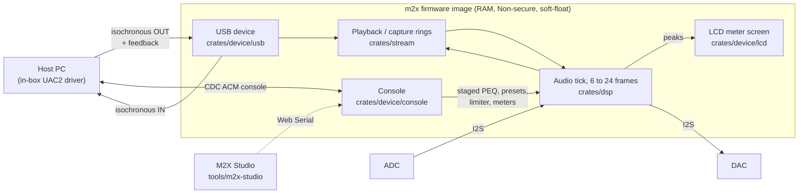

# m2x

Open firmware, written in `no_std` Rust, for a 2-in/2-out USB audio interface built on the NXP LPC55S28
(Cortex-M33). It turns the interface into a class-compliant USB Audio Class 2 device with a 14-band parametric EQ,
a zero-clip trim, a look-ahead peak limiter, a live LCD meter screen and a text console. A browser app,
M2X Studio, drives it over that console.

Every line of the audio path is host-tested, bit-exact golden vectors pin its output, and an emulator runs the real
Cortex-M33 machine code to price each audio tick in instructions before any of it meets hardware.

> **Hardware revision warning.** Developed and tested on the NXP LPC55S28 hardware revision of the MOTU M2 only.
> Other revisions use other parts and pin maps, and this image will not work on them. Independent open-source
> project; not affiliated with or endorsed by MOTU, NXP, ESS Technology, or AKM. Read [DISCLAIMER.md](DISCLAIMER.md)
> and [SAFETY.md](SAFETY.md) before you go near a device.

## Try it in 60 seconds, with no hardware

You need a Rust toolchain (1.85 or newer) and, for the last step, a Chromium browser.

```sh
git clone <this repository> m2x && cd m2x
cargo test --workspace                       # about 1,170 host tests: DSP, USB state machines, descriptors, golden vectors
cargo run -p device --features sound3 --example preset_impulse -- out
                                             # writes each preset's impulse response at 44.1, 48 and 96 kHz as raw f64
```

Then open [`tools/m2x-studio/index.html`](tools/m2x-studio/index.html). With no device connected, an emulated
firmware answers in the real reply formats, so you can drag EQ nodes, switch presets, import an APO text file and
watch the telemetry panels.

## What it does



Each tick takes one block of USB samples and runs gain, the 14 biquads, the trim, the limiter and the meters. It
then hands the block to the DAC, and pulls a capture block from the ADC back the other way. Coefficients are
designed off the hot path and swapped in at a block boundary with a short crossfade, so a preset change never
clicks.

| | |
|---|---|
| Target | NXP LPC55S28, Cortex-M33 with DSP, run Non-secure; `thumbv8m.main-none-eabi`, soft-float (`-fpregs`) |
| USB | UAC2, 2 in and 2 out, 24-bit samples in 32-bit slots, asynchronous with explicit feedback; CDC ACM console |
| USB identity | `1209:0001`, the pid.codes open test pair |
| Sample rates advertised | 44.1, 48, 88.2, 96, 176.4 and 192 kHz |
| EQ | 14 RBJ cookbook biquads (peak, low shelf, high shelf, high pass, low pass), 20 Hz to 20 kHz, ±12 dB, Q 0.3 to 10 |
| Presets | `flat` (bit-perfect, the boot default), `clarity` (EQ1, trim −2.6 dB), `warm` (EQ2, trim −4.2 dB) |
| Zero-clip trim | −⌈peak × 10⌉ / 10 of the worst boost over every rate and band set a preset can play |
| Limiter | ceiling −20.0 to 0.0 dBFS, release 5 to 1000 ms; default −1.0 dBFS and 50 ms |
| Core clock | 96 MHz at boot, raised to 150 MHz in the `sound3` build so all 14 bands run at 88.2 and 96 kHz |
| Image | runs from RAM; holds no flash erase or program path, and `cargo xtask scan-image` checks that on every build |

## Build the firmware image

```sh
rustup target add thumbv8m.main-none-eabi
cargo firmware-sound3        # the newest image: 150 MHz core, 14 bands at every rate, the LCD meter screen
cargo firmware               # the minimal milestone image
```

The ELF lands in `target/thumbv8m.main-none-eabi/<profile>/board`. The build ladder in `crates/board/Cargo.toml`
runs `milestone` → `milestone2` → `milestone4` → `milestone7` → `sound1` → `sound2` → `sound2-ui` → `sound3`, and
each step adds one capability. This repository builds and checks images. It ships no tool that loads them onto a
device. See [SAFETY.md](SAFETY.md) for why.

## Check it

```sh
cargo fmt --check
cargo test --workspace
cargo xtask scan-image       # no VFP instruction, no flash-controller address, nothing banned on the audio path
cargo xtask link-check       # image size and stack reserve
python -m venv .venv && .venv/Scripts/pip install unicorn==2.1.4     # or .venv/bin/pip on Linux and macOS
cargo xtask budget           # cycles per audio tick and per USB interrupt, on the emulated M33
cargo xtask board-run        # boot the real image on a modelled board and check its bus traffic
node tools/m2x-studio/test.mjs
```

## Read next

- [ONBOARDING.md](ONBOARDING.md): set up, find your way around and make a first change.
- [ARCHITECTURE.md](ARCHITECTURE.md): the crates, the audio tick, and how the checks prove what they prove.
- [SAFETY.md](SAFETY.md): what can go wrong on a real device, and the rules that keep it from happening.
- [CONTRIBUTING.md](CONTRIBUTING.md): code rules, tests and pull requests.
- [DISCLAIMER.md](DISCLAIMER.md): warranty, trademarks and provenance.
- [THIRD_PARTY_NOTICES.md](THIRD_PARTY_NOTICES.md): the NXP SVD licence and other attributions.

## License

Dual-licensed under [MIT](LICENSE-MIT) or [Apache-2.0](LICENSE-APACHE), at your option.
